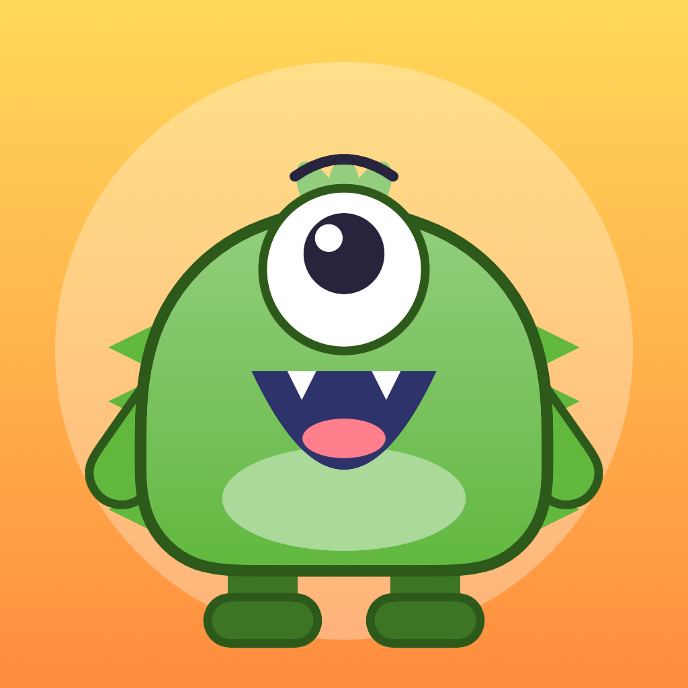
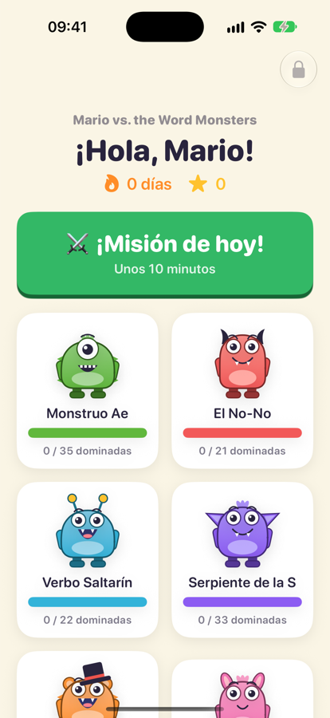
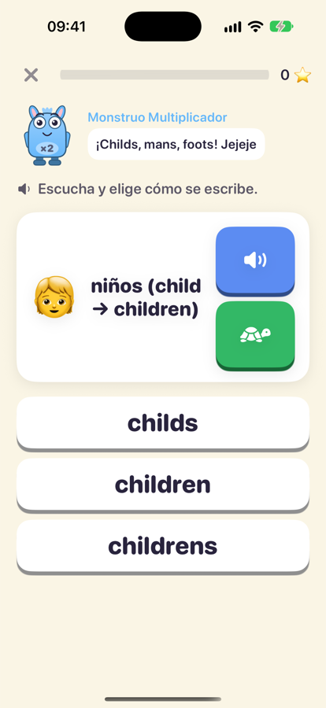
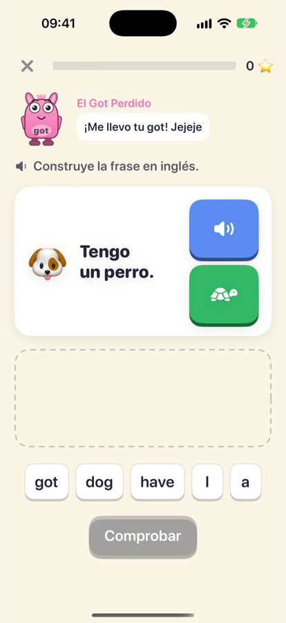
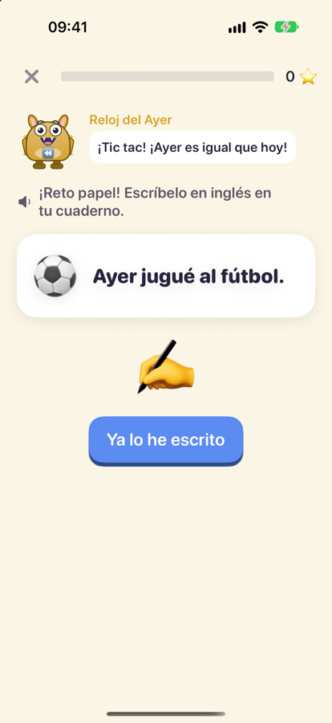
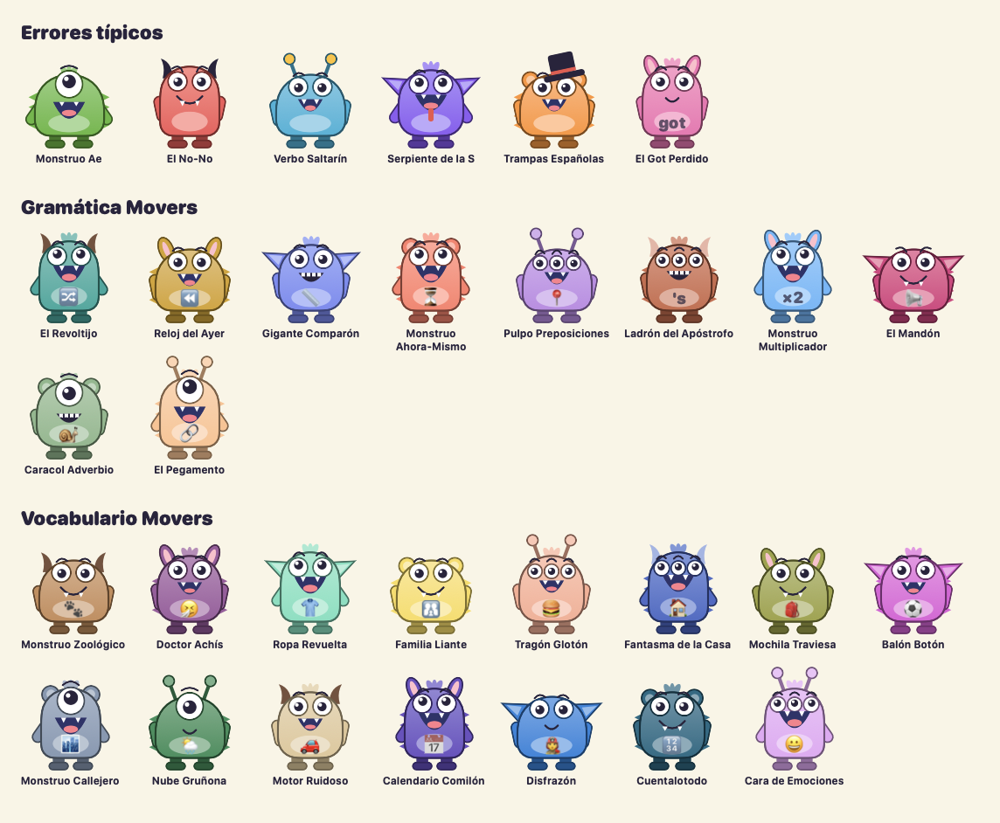
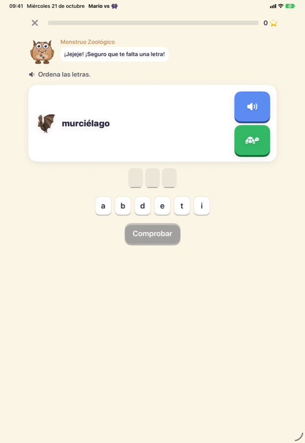

<p align="center">
  
</p>

<h1 align="center">Mario vs. the Word Monsters 👾</h1>

<p align="center">
  <b>A free, open-source iPhone & iPad app that helps Spanish-speaking kids learn to <i>write</i> English, not just speak it.</b><br>
  Cambridge Young Learners (Movers · A1) · Spaced repetition · Speech recognition · No ads, no accounts, no tracking
</p>

<p align="center">
  
  
  
  
  
</p>

<p align="center"><a href="#-en-español">🇪🇸 Leer en español</a></p>

---

## Why this app exists

Lots of bilingual and bilingual-school kids in Spain **speak English fluently but fail written tests**. They write the way they speak (`Ae` for *I*, `neclake` for *necklace*) and they build sentences with Spanish grammar (`She is no home`, `You are happy?`, `I have 10 years`).

Flashcard and Duolingo-style apps don't attack those specific habits. **Mario vs. the Word Monsters** does. It was built for one real 8-year-old, from his own marked worksheets. Every wrong option in the app is a mistake he actually made.

<p align="center">
  
  
  
  
</p>

## The monsters

Each typical error made by Spanish speakers is a monster. Kids **hunt the mistake** instead of hiding it.

| Monster | Error pattern | Real examples |
|---|---|---|
| 🟢 **Monstruo Ae** | Phonetic spelling | `Ae` → I, `hear` → hair, `monay` → money |
| 🔴 **El No-No** | Negating with Spanish *no* | `I no late` → I'm not late |
| 🔵 **Verbo Saltarín** | Questions without inversion | `You are happy?` → Are you happy? |
| 🟣 **Serpiente de la S** | Pronouns & 3rd-person **-s** | `she play` → she plays |
| 🟠 **Trampas Españolas** | Word-for-word calques | `I have 10 years` → I am 10 years old |
| 🩷 **El Got Perdido** | Dropping *got* from *have got* | `I have a dog` → I have got a dog |

These six are switched on by default. Every one can be turned off in the parent area.

### The whole Movers syllabus (opt-in)

The app also covers the **full Cambridge Movers (A1) level**, so other children can use it and kids can get ahead. These monsters start **switched off**. Parents turn them on in *Ajustes → Monstruos* one by one, by group, or all at once, as each topic comes up at school. Switching a monster off never deletes its progress.

- **Movers grammar** (10 monsters): word order with adjectives and frequency adverbs, past simple and irregular verbs, comparatives and superlatives, present continuous, prepositions of place and time, possessives (`'s`, *whose*, *mine*, *its/it's*), irregular plurals, modals (*must*, *have to*, *can*, *could*, *shall*), adverbs (*well*, *quickly*) and linkers (*who*, *which*, *where*, *because*).
- **Movers vocabulary** (15 monsters): animals, body and health, clothes, family, food, home, school, sports, town, weather and nature, transport, time, jobs, numbers and feelings. Each word comes with the misspellings a Spanish speaker typically makes (`fourty`, `ninty`, `dolfin`).

In total there are 31 monsters and about 550 cards.

<p align="center">
  
</p>

Every monster is drawn in code with SwiftUI shapes, so each one has its own colour, body, ears or horns, eyes and mouth, plus an emblem on its belly. Because they aren't bitmaps they can react during a session: they bounce when idle, wince when the child gets a card right, laugh when the child falls into the trap and end up with X eyes once they're defeated. The green one-eyed Monstruo Ae, the first monster, is also the app icon (green is Mario's favourite colour).

## How it teaches

- **A ladder from strength to weakness.** Each card climbs from what the child already does well (listening and speaking) to what they need to learn (writing):
  1. Listen and choose the spelling.
  2. Say it aloud (on-device speech recognition).
  3. Repair the monster's sentence.
  4. Build it with tiles, or spell it with a big, simple keyboard.
  5. **Write it on paper** and self-check with a "detective" checklist.
- **Purposeful distractors.** The trap tiles are the child's own typical mistakes, so every right answer means rejecting the error on purpose.
- **Spaced repetition (Leitner boxes).** Missed cards come back a few cards later and again the next day. Mastered cards return after 2, 4, 8 and 21 days.
- **Immediate, specific feedback.** You see the right form next to your crossed-out answer, plus the *why*, explained (and read aloud) in Spanish.
- **Short daily missions**: about 10 cards, 8–12 minutes.
- **Parent area** behind a PIN, with weekly stats, mastery per monster, the most repeated mistakes and accuracy per exercise type.

<p align="center">
  
</p>

## Privacy

Everything stays on the device. There are **no accounts, ads, analytics or network calls**. Speech recognition runs on-device.

## Build & run

Requirements: Xcode 16+ and [XcodeGen](https://github.com/yonaskolb/XcodeGen).

```bash
git clone https://github.com/oskarko/mario-vs-word-monsters.git
cd mario-vs-word-monsters
xcodegen generate
open MarioMonsters.xcodeproj
```

To run it on a real device, pick your signing team in Xcode.

Tests (Swift Testing):

```bash
xcodebuild test -project MarioMonsters.xcodeproj -scheme MarioMonsters \
  -destination 'platform=iOS Simulator,name=iPhone 16'
```

## Make it your own child's app

All the content lives in [`Curriculum.swift`](MarioMonsters/Model/Curriculum.swift) (the typical errors) and [`CurriculumMovers.swift`](MarioMonsters/Model/CurriculumMovers.swift) (the Movers syllabus). Each card is one line: the correct English, the Spanish meaning, an emoji, and the **real mistakes your child makes**:

```swift
s(.noNo, "She isn't at home.", "Ella no está en casa.", "🏠", ["She is no home.", "She no at home."])
w(.ae, "necklace", "collar", "📿", ["neclake", "nekleis"])
```

Change the child's name in the parent area. Pull requests with new cards, new monsters (other native languages too!) or accessibility improvements are very welcome.

## Project structure

```
MarioMonsters/
├── Model/       Cards, curriculum, SwiftData models
├── Engine/      Scheduler (Leitner), session planner, answer checker, exercises
├── Services/    Text-to-speech, speech recognition, settings
└── Views/       Home, session, exercises, monsters, parent area
MarioMonstersTests/   Engine tests
Scripts/              App icon renderer (draws the icon from MonsterView)
```

## License

[GNU GPL v3](LICENSE). The app is free and must stay free: anyone can use it, study it, adapt it for their own kids and share it, as long as their changes stay open too.

---

## 🇪🇸 En español

**App gratuita y de código abierto para iPhone y iPad que ayuda a niños hispanohablantes a _escribir_ en inglés lo que ya saben decir.** Es de nivel Cambridge Movers (A1), para Primaria y colegios bilingües.

La hicimos para Mario, de 8 años, que habla muy bien inglés pero escribe como habla y piensa en español. Todo el contenido sale de sus propias fichas corregidas.

### El problema
Cometía unos pocos errores de raíz, siempre los mismos. Cada uno es un monstruo que Mario tiene que derrotar:
- **Monstruo Ae:** escribe las palabras como suenan.
- **El No-No:** niega con el «no» del español.
- **Verbo Saltarín:** hace preguntas sin poner el verbo delante.
- **Serpiente de la S:** confunde pronombres y olvida la -s de la tercera persona.
- **Trampas Españolas:** traduce palabra por palabra.
- **El Got Perdido:** se come el «got» de «have got».

Estos seis vienen activados por defecto, y cualquiera se puede desactivar.

Los monstruos están dibujados con SwiftUI, sin imágenes: son peluditos y simpáticos, cada uno con su color, sus orejas o cuernos, sus ojos y su emblema en la barriga. Se mueven durante la sesión: se ríen cuando el niño cae en la trampa, se quejan cuando acierta y acaban con los ojos en X cuando los derrota. El Monstruo Ae es verde campo, el color favorito de Mario, y es también el icono de la app.

### Todo el nivel Movers
La app incluye además **toda la gramática y el vocabulario de Movers**: 10 monstruos de gramática (pasado, comparativos, preposiciones, modales, posesivos, plurales irregulares…) y 15 de vocabulario (animales, ropa, comida, números, profesiones…). Vienen **desactivados**. En *Ajustes → Monstruos* puedes activarlos uno a uno, por grupos o todos a la vez, según los vayan dando en clase. Si desactivas uno, su progreso no se pierde.

### Cómo enseña
- **Externalizar el error.** El fallo es «el monstruo intenta engañarte», no «lo haces mal». El niño caza el error en vez de esconderlo.
- **Escalera por tarjeta:** oír y elegir → decirlo en voz alta → arreglar la frase → construirla con fichas o deletrearla → **escribirla en papel** y revisarla en «modo detective». No exige usar el teclado del móvil.
- **Opciones trampa con sentido:** son sus propios errores, así que tiene que rechazarlos a conciencia.
- **Repetición espaciada:** lo que falla vuelve enseguida y al día siguiente. Lo que domina vuelve a los 2, 4, 8 y 21 días.
- **Corrección inmediata**, explicada en español y con voz.
- **Misiones cortas** de unos 10 minutos al día.

### Zona de padres
Toca el candado y crea un PIN de 4 cifras. Verás:
- la racha y los aciertos de la semana;
- el dominio de cada monstruo;
- **los errores que más repite**, con lo último que escribió;
- los aciertos por tipo de ejercicio.

**Consejo:** lo que mejor predice la nota del colegio es el apartado **«Escribir en papel»**.

### Adáptala a tu hijo o hija
Edita [`Curriculum.swift`](MarioMonsters/Model/Curriculum.swift). Cada tarjeta es una línea con la frase correcta, la traducción, un emoji y los errores reales del niño. Cambia el nombre en la zona de padres.

### Licencia
[GPL v3](LICENSE). La app es gratis y seguirá siéndolo: cualquiera puede usarla, adaptarla y compartirla, siempre que sus cambios también sean libres.

<sub>Keywords: learn English for kids, ESL app for Spanish speakers, inglés para niños, Cambridge Movers, Young Learners A1, spelling practice, dictation, dyslexia-friendly writing practice, spaced repetition, Leitner, SwiftUI education app, open source iOS app, bilingual school, primaria, aprender a escribir en inglés.</sub>
